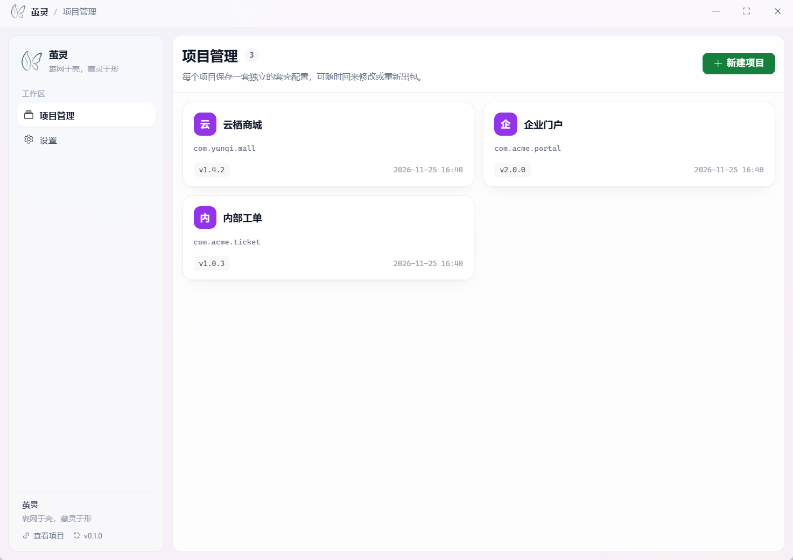
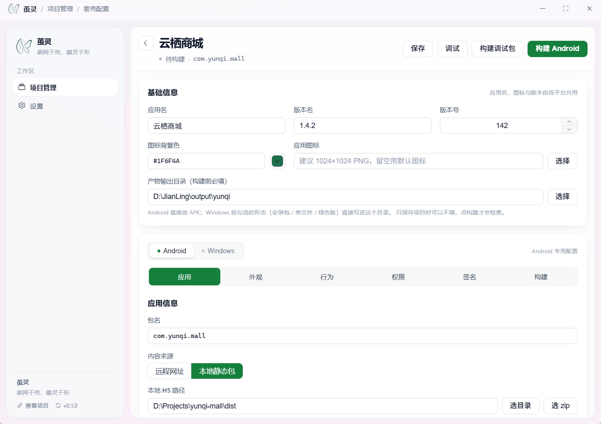
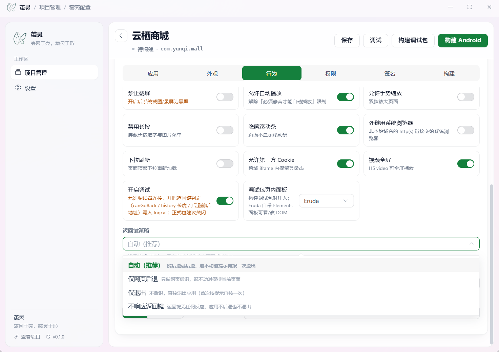
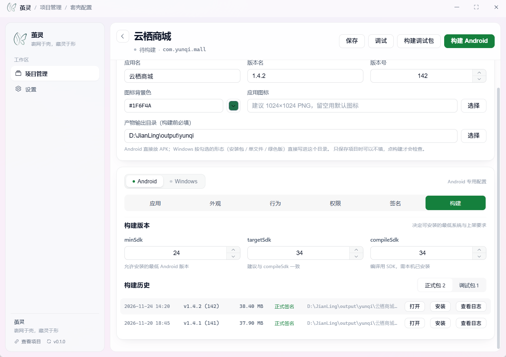

# 茧灵（JianLing）

裹网于壳，藏灵于形。

茧灵是一个把 H5 页面封装成 Android 应用与 Windows 桌面程序的图形化工具。选择本地静态包或远程网址，配置权限、转发规则与启动参数，一键产出 APK、安装包与绿色版，并内置设备调试能力。

## 功能特性

### 应用打包

- Android：内容来源支持本地静态包与远程网址；可配置包名、版本、图标、权限、状态栏、启动屏、下拉刷新、顶部操作栏、缓存策略等。
- Windows：支持单文件 exe、安装包与绿色版 zip 三种产物。
- 调试包与正式包可同时安装（调试包包名带 `.debug` 后缀）。

### 内置本地服务与接口转发

- 页面以 `http://127.0.0.1` 同源托管，`/api`、`/ws` 等相对路径由本地服务转发到后端，前端无需绑定域名，后端无需配置跨域。
- 转发规则按前缀匹配（最长优先），支持 http(s) 与 ws(s)、Origin 改写、自签证书、固定 IP 解析、追加请求头。
- 运行期可把前端构建产物推送到应用外部目录，免去每次改动都重新打包。

### 页面能力

- 页面脚本执行前注入 `window.JianLing`，可读取壳版本与设备信息，也可据此判断当前是否运行在壳内。
- 支持文件选择、下载转存、权限申请提示、状态栏高度 CSS 变量等原生能力。

### 调试工具

- 设备列表与安装启动、System WebView 版本查看、屏幕常亮。
- 一键连接完整 DevTools（复制 `devtools://` 地址），支持 Console / Network / Sources 直达。
- 实时查看设备日志，支持关键字过滤与自动刷新。
- 应用内自动检测新版本。

## 界面预览

### 项目管理

集中管理多个套壳项目，包名、版本与最近构建时间一目了然。

### 套壳配置

应用基础信息与 Android / Windows 平台配置分区展示，按需切换。

### 返回键策略

返回键行为收敛为一个下拉，四档策略自带说明，一般保持「自动」即可。

### 构建历史与一键安装

每次构建保留产物路径与签名状态，可直接把 APK 安装到当前连接的 Android 设备。

## 更新日志

### v0.2.0

- 返回键策略合并为一个下拉，提供自动 / 仅网页后退 / 仅退出 / 不响应返回键四档并附说明；新增 `none` 策略，旧「禁止返回键退出应用」配置自动迁移为仅网页后退。
- 构建历史每行新增「安装」，在弹窗中选择 ADB 设备并安装对应 APK；移除构建成功状态卡片。
- README 增加界面预览截图。

## 许可证

本项目基于 GNU Affero General Public License v3.0 发布，详见 [LICENSE](LICENSE)。
